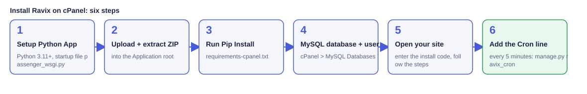
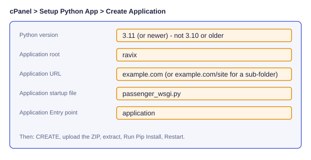
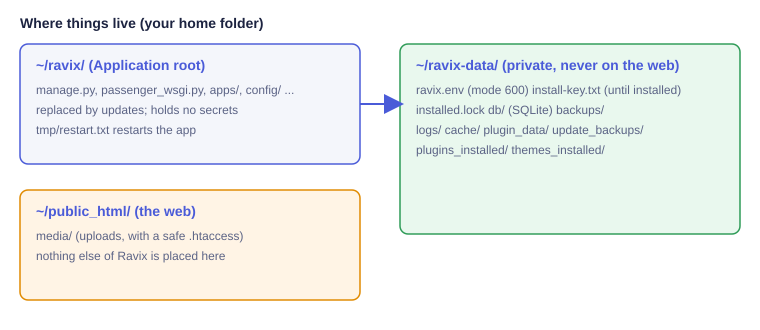

# نصب Ravix روی هاست اشتراکی cPanel

نصب Ravix روی cPanel مثل وردپرس است: آپلود، باز کردن سایت در مرورگر و پاسخ به چند پرسش. بدون root و بدون SSH.
(English: [cpanel.md](cpanel.md)؛ زبان‌های دیگر: [cpanel/](cpanel/).) نصب روی VPS مسیر جدایی است (`install.sh`، [deployment.md](deployment.md)) و تغییری نکرده است.



## پیش‌نیازها
* cPanel با **Setup Python App** (Passenger/CloudLinux) یا هاست LiteSpeed با همان بخش. پایتون **۳٫۱۱ یا بالاتر**. پایتون ۳٫۱۰ و پایین‌تر منقضی است و با پیام روشن رد می‌شود: در Setup Python App نسخهٔ جدیدتر را انتخاب کنید.
* یک پایگاه‌دادهٔ MySQL/MariaDB (cPanel ▸ MySQL® Databases). SQLite هم کار می‌کند (نصب‌کننده هشدار می‌دهد)؛ برای سایت واقعی MySQL پیشنهاد می‌شود.
* حدود ۱ گیگابایت حافظه کافی است؛ کار سنگین داخل درخواست وب انجام نمی‌شود.
* هاست نباید خیلی قدیمی باشد: Pillow، cryptography و nh3 به صورت wheel آماده (`manylinux2014` یا جدیدتر) نصب می‌شوند. اگر نصب با پیام wheel خطا داد، هاست قدیمی است: از پشتیبانی بخواهید پایتون/CloudLinux جدیدتر بدهد یا از VPS استفاده کنید.

## ۱. ساخت برنامهٔ پایتون


۱. cPanel ▸ **Setup Python App** ▸ **Create Application**.
۲. نسخهٔ پایتون ۳٫۱۱+؛ **Application root** برابر `ravix`؛ **Application URL** دامنهٔ شما (یا `example.com/site` برای نصب در زیرپوشه؛ لینک‌ها و ریدایرکت‌ها درست کار می‌کنند).
۳. Startup file برابر `passenger_wsgi.py` و Entry point برابر `application` ← **Create**.

## ۲. آپلود بسته
فایل `ravix-<نسخه>-cpanel.zip` را بگیرید (برای بررسی، فایل `.sha256` کنارش است). در **File Manager** پوشهٔ `ravix` را باز کنید، ZIP را آپلود و همان‌جا **Extract** کنید و سپس ZIP را پاک کنید.



## ۳. نصب بسته‌های پایتون
در Setup Python App روی برنامه بزنید و **Run Pip Install** را اجرا کنید (فایل `requirements-cpanel.txt`). اگر Terminal دارید:
```
source ~/virtualenv/ravix/3.11/bin/activate
pip install --only-binary=:all: -r ~/ravix/requirements-cpanel.txt
```
سپس در Setup Python App دکمهٔ **Restart** را بزنید.

## ۴. ساخت پایگاه‌داده
cPanel ▸ **MySQL® Databases**: یک پایگاه‌داده و یک کاربر بسازید و کاربر را با **All privileges** به پایگاه‌داده اضافه کنید. cPanel پیشوند (`cpuser_`) می‌افزاید؛ نام‌ها را بنویسید.

## ۵. اجرای نصب‌کنندهٔ وب
سایت را باز کنید. فقط یک کادر «کد نصب» دیده می‌شود. کد در فایل `install-key.txt` داخل پوشهٔ `ravix-data` (کنار پوشهٔ `ravix`) است؛ با File Manager بخوانید. بدون کد هیچ مرحله‌ای نمایش داده نمی‌شود و تلاش‌های اشتباه محدود می‌شوند.

سپس میزبان بررسی می‌شود (نسخهٔ پایتون، پوشه‌های قابل‌نوشتن، حافظه، سقف آپلود، اتصال پایگاه‌داده)، اطلاعات پایگاه‌داده، نام سایت و مدیر پرسیده و نصب اجرا می‌شود. در پایان نصب‌کننده **برای همیشه قفل می‌شود** (`installed.lock`)، کد نصب پاک می‌شود و `ravix-data/ravix.env` با دسترسی ۶۰۰ نوشته می‌شود. اگر SSL فعال است، نصب‌کننده خودکار به HTTPS می‌رود.

## ۶. افزودن Cron
آخرین صفحهٔ نصب‌کننده خط دقیق را نشان می‌دهد. cPanel ▸ **Cron Jobs** ▸ هر ۵ دقیقه:
```
*/5 * * * * cd /home/USER/ravix && DJANGO_SETTINGS_MODULE=config.settings.hosting /home/USER/virtualenv/ravix/3.11/bin/python manage.py ravix_cron >/dev/null 2>&1
```
همین یک فرمان همه‌چیز را انجام می‌دهد: انتشار زمان‌بندی‌شده، پاک‌سازی، صف ایمیل، **پشتیبان روزانه** (در `ravix-data/backups`، نه `public_html`) و یک درخواست سبک به صفحهٔ اصلی تا Passenger بیدار بماند (از تنظیمات ▸ سرعت خاموش می‌شود). اجراها هم‌زمان نمی‌شوند.

## کار روزمره
* **سلامت سایت** نشان می‌دهد cron کی اجرا شد، کش کار می‌کند یا نه و آخرین پشتیبان کی بود.
* **سرعت** (تنظیمات سایت ▸ سرعت): کش صفحهٔ مهمان‌ها (روی هاست اشتراکی پیش‌فرض روشن)؛ کاربر واردشده، سبد فروشگاه، فرم‌ها و صفحه‌های CSRF هرگز کش نمی‌شوند و با هر تغییر محتوا کش پاک می‌شود.
* **ایمیل**: پنل ▸ ایمیل برای SMTP و دکمهٔ «ارسال ایمیل آزمایشی». ایمیل‌های ناموفق در صف می‌مانند و cron دوباره می‌فرستد.
* **به‌روزرسانی**: پنل ▸ به‌روزرسانی مثل همیشه (با پشتیبان خودکار قبل از آن) یا آپلود ZIP به‌روزرسانی. برنامه خودش راه‌اندازی مجدد می‌شود.

## Passenger یا LiteSpeed؟
هر دو `passenger_wsgi.py` را اجرا می‌کنند و همان `.htaccess` را می‌خوانند (فقط دستورهای مشترک). راه‌اندازی مجدد: **Restart** در Setup Python App؛ خود Ravix هم `tmp/restart.txt` را لمس می‌کند. با سرور شبیه Passenger آزموده شده؛ خود LiteSpeed (LSAPI) در CI **اجرا نشده است**.

## نکات امنیتی
`DEBUG` همیشه خاموش است. `ravix.env`، فایل SQLite و پشتیبان‌ها بیرون از `public_html` هستند و یک آزمون تضمین می‌کند از وب سرو نشوند. پوشهٔ media یک `.htaccess` محافظ دارد. هدرهای امنیتی بدون Nginx هم برقرارند. پشت reverse proxy مقدار `RAVIX_BEHIND_PROXY=true` را در `ravix.env` بگذارید.

## عیب‌یابی
| نشانه | راه‌حل |
|---|---|
| **۵۰۳ / Incomplete response** در Passenger | فایل `ravix-data/logs/startup-error.txt` را بخوانید. علت‌های رایج: بسته‌ها نصب نشده‌اند (مرحلهٔ ۳)، نسخهٔ پایتون نادرست، پوشهٔ غیرقابل‌نوشتن. پس از رفع Restart بزنید. |
| `ModuleNotFoundError` | Run Pip Install را با virtualenv همان برنامه دوباره اجرا کنید و نسخهٔ پایتون ۳٫۱۱+ را ببینید. |
| صفحهٔ «پایتون قدیمی است» | نسخه را در Setup Python App به ۳٫۱۱ یا بالاتر بدهید و Restart بزنید. |
| خطای ساخت Pillow/cryptography | هاست قدیمی است (wheel نمی‌یابد). از پشتیبانی پایتون/CloudLinux جدیدتر بخواهید یا VPS بگیرید. |
| پوشه قابل‌نوشتن نیست | در File Manager دسترسی پوشه‌ها `755` و فایل‌ها `644` و مالک حساب خودتان؛ `ravix-data` باید برای شما قابل‌نوشتن باشد. |
| کد نصب گم شد | `ravix-data/install-key.txt` را باز کنید. اگر فایل نیست و سایت هنوز نصب نشده، صفحهٔ نصب را تازه کنید تا کد جدید ساخته شود. |
| پس از ویرایش صفحه تازه نمی‌شود | تنظیمات ▸ سرعت ▸ پاک‌کردن کش؛ برای انتشار زمان‌بندی‌شده cron باید فعال باشد. |
| میزبان پردازش پس‌زمینه را کشت | در Terminal: `python manage.py ravix_host_install --resume`. |
