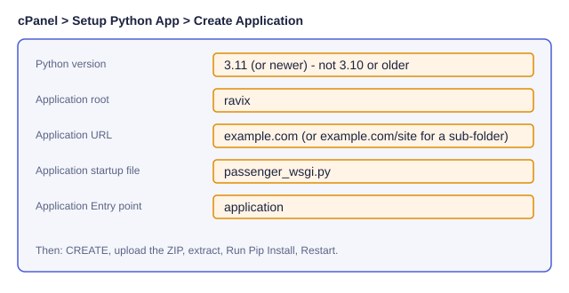
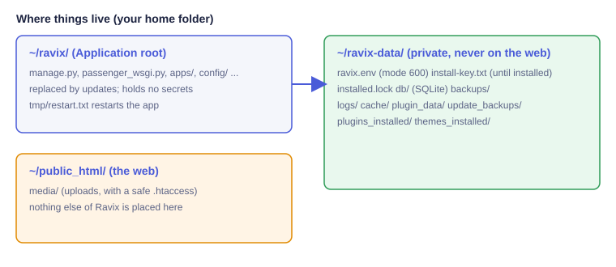

# Installing Ravix on cPanel shared hosting

Ravix installs on an ordinary cPanel host the way WordPress does: upload, open the site in a browser, answer a few questions. No root, no SSH required.
(Persian: [cpanel.fa.md](cpanel.fa.md); other languages: [cpanel/](cpanel/).) A VPS install is a different path (`install.sh`, see [deployment.md](deployment.md)) and is not affected.


## What you need
* cPanel with **Setup Python App** (CloudLinux Passenger) **or** a LiteSpeed host that offers the same screen. Python **3.11 or newer**. Python 3.10 and older are end of life and are refused with a clear message: pick a newer version in Setup Python App.
* A MySQL / MariaDB database (cPanel ▸ MySQL® Databases). SQLite also works (the installer warns you); MySQL is recommended for real sites.
* About 1 GB RAM is enough. Nothing heavy runs inside a web request.
* A host that is not very old: the packages Pillow, cryptography and nh3 are installed as ready-made wheels (`manylinux2014` or newer). If the install fails with a message about wheels, the host is too old: ask support to enable a newer Python / CloudLinux version, or use a VPS.

## 1. Create the Python application


1. cPanel ▸ **Setup Python App** ▸ **Create Application**.
2. Python version 3.11+; **Application root** `ravix`; **Application URL** your domain (or `example.com/site` to install in a sub-folder; this works, links and redirects follow the folder).
3. Startup file `passenger_wsgi.py`, entry point `application`. Press **Create**.

## 2. Upload the package
Download `ravix-<version>-cpanel.zip` (and its `.sha256` to check it). In **File Manager** open the folder `ravix` (the Application root), upload the ZIP and **Extract** it there. Delete the ZIP afterwards.



## 3. Install the Python packages
In Setup Python App open your application and press **Run Pip Install** (it reads `requirements-cpanel.txt`). If your host has a Terminal:
```
source ~/virtualenv/ravix/3.11/bin/activate
pip install --only-binary=:all: -r ~/ravix/requirements-cpanel.txt
```
Then press **Restart** in Setup Python App.

## 4. Create the database
cPanel ▸ **MySQL® Databases**: create a database and a user, add the user to the database with **All privileges**. Note the three names; cPanel adds a prefix (`cpuser_`).

## 5. Run the web installer
Open your site. Nothing is shown except a box asking for the **install code**. The code is in the file `install-key.txt` in the folder `ravix-data`, next to your `ravix` folder (File Manager ▸ open it). Without the code the installer shows no step at all, and wrong attempts are rate-limited.

The installer then checks the host (Python version, writable folders, memory, upload limit, database connection), asks for the database details, the site name and the administrator, and runs the installation. When it finishes it **locks itself for good** (`installed.lock`), deletes the install code and writes `ravix-data/ravix.env` (mode 600). Keep your site URL as `https://` if SSL is active: the installer redirects to HTTPS automatically when it finds a working certificate.

## 6. Add the cron job
The last installer page shows the exact line. It looks like this: cPanel ▸ **Cron Jobs** ▸ every 5 minutes:
```
*/5 * * * * cd /home/USER/ravix && DJANGO_SETTINGS_MODULE=config.settings.hosting /home/USER/virtualenv/ravix/3.11/bin/python manage.py ravix_cron >/dev/null 2>&1
```
One command does everything: scheduled publishing, cleanups, the email queue, a **daily backup** (saved in `ravix-data/backups`, never in `public_html`) and a light request to your home page so Passenger stays awake (switch in Site settings ▸ Speed). Runs never overlap.

## Everyday use
* **Site health** (panel ▸ Site health) shows when cron last ran, whether the page cache works and when the last backup was made.
* **Speed** (panel ▸ Site settings ▸ Speed): the guest page cache (on by default on shared hosting; logged-in users, the shop cart, forms and CSRF pages are never cached; the cache is cleared whenever content changes).
* **Email**: panel ▸ Email lets you set SMTP and press **Send a test email**. Mails that fail are queued and retried by cron.
* **Updates**: panel ▸ Updates works as usual (an automatic backup is made first) or upload an update ZIP there. The application restarts itself.
* **Backups** live in `ravix-data/backups`; download them from the File Manager.

## Passenger or LiteSpeed?
Both run `passenger_wsgi.py` and read the same `.htaccess` files (only directives both understand are used). Restart: Setup Python App ▸ **Restart** on either; Ravix itself touches `tmp/restart.txt` and `passenger_wsgi.py`, which both servers watch. Tested here with a Passenger-like server; LiteSpeed (LSAPI) itself was **not** run in CI.

## Security notes
`DEBUG` is always off. `ravix.env`, the SQLite file and backups live outside `public_html`, and a test checks that they are never served. Media uploads get a protective `.htaccess` (no script execution). Security headers are set by Django itself, no Nginx needed. If you use a reverse proxy, set `RAVIX_BEHIND_PROXY=true` in `ravix.env`.

## Troubleshooting
| Symptom | Fix |
|---|---|
| **503 / "Incomplete response"** from Passenger | Open `ravix-data/logs/startup-error.txt`. Usual causes: packages not installed (step 3), wrong Python version, a folder not writable. Press Restart after fixing. |
| `ModuleNotFoundError` / import error | Run Pip Install again with the application's virtualenv; check the Python version is 3.11+. |
| "This Python is too old" page | Setup Python App ▸ change the version to 3.11 or newer, Restart. |
| Pip fails building Pillow/cryptography | The host is old (no `manylinux2014` wheels). Ask support for a newer Python / CloudLinux, or use a VPS. |
| Folder not writable | File Manager ▸ permissions `755` for folders, `644` for files, owned by your account; `ravix-data` must be writable by you. |
| Lost the install code | Open `ravix-data/install-key.txt` in File Manager. If the file is missing while the site is not installed yet, reload the installer page: a new code is created. |
| The installer ran but the site shows setup again | Cron/`ravix.env` not found: check that `ravix-data/ravix.env` exists next to the application folder (or set `RAVIX_DATA_DIR`). |
| Pages not refreshing after edit | Panel ▸ Speed ▸ clear the cache; cron must be running for scheduled posts. |
| Background install stopped by the host | In Terminal: `python manage.py ravix_host_install --resume`. |
